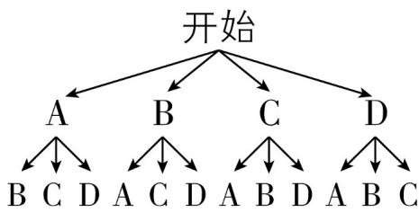

> [!success]- 必刷题
>
> > [!success] **【答案】** A
>
> > [!note]- **【解析】**
> > 画树状图如下：
> >
> > 
> >
> > ∵ 共有 12 种等可能的结果, 任意闭合其中两个开关, 小灯泡发光的有 6 种, ∴ 所求概率为 $\frac{6}{12} = \frac{1}{2}$ . 故选 A.
> >
> > 初中必刷题 数学九年级上册 BS
