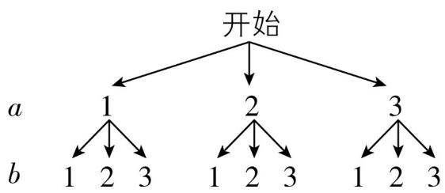

> [!success]- 必刷题
>
> > [!success] **【答案】** $\frac{2}{3}$
>
> > [!note]- **【解析】**
> > 画出树状图如下：
> >
> > 
> >
> > 共有9种等可能的结果,其中 $a \leqslant b$ 的结果有6种, $\therefore a \leqslant b$ 的概率是 $\frac{6}{9} = \frac{2}{3}$ . 故答案为 $\frac{2}{3}$ .
