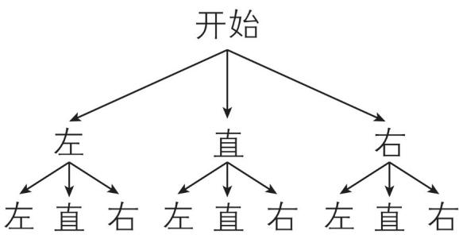

> [!success]- 必刷题
>
> > [!success] **【答案】** $\frac{2}{9}$
>
> > [!note]- **【解析】**
> > 画树状图如下:
> >
> > 
> >
> > ∴ 这两辆汽车行驶方向共有 9 种可能的结果,且所有结果的可能性相等,两辆汽车一辆左转,一辆右转的结果有 2 种,∴ P(两辆汽车一辆左转,一辆右转) = $\frac{2}{9}$ . 故答案为 $\frac{2}{9}$ .
> >
> > 思路分析列表得出所有等可能的情况数,找出满足关于x的方程 $x^{2}+px+q=0$ 有实数根的情况数,即可得出所求的概率.
