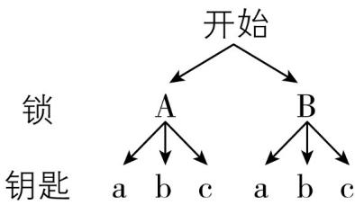

> [!success]- 必刷题
>
> > [!success] **【答案】** $\frac{1}{3}$
>
> > [!note]- **【解析】**
> > 根据题意画出树状图如下：
> >
> > 
> >
> > 由树状图知,所有可能出现的结果共有6种,这些结果出现的可能性相等.其中取出的钥匙恰好能打开取出的锁的结果有2种,∴取出的钥匙恰好能打开取出的锁的概率等于 $\frac{2}{6}=\frac{1}{3}$ .故答案为 $\frac{1}{3}$ .
