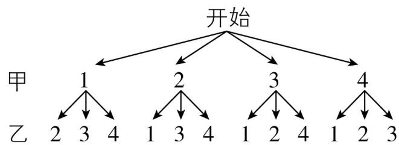

> [!success]- 必刷题
>
> > [!success] **【答案】** A
>
> > [!note]- **【解析】**
> > 把四个赛道分别记为 1,2,3,4,画树状图如下:
> >
> > 
> >
> > 由树状图可知, 共有 12 种等可能的结果, 其中甲、乙两名同学恰好抽中相邻赛道的结果有 6 种, ∴ 甲、乙两名同学恰好抽中相邻赛道的概率为 $\frac{6}{12} = \frac{1}{2}$ .
> >
> > 故选 **A**.
