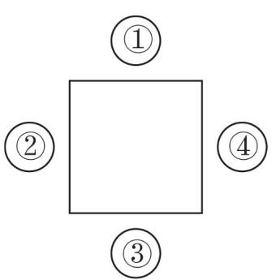
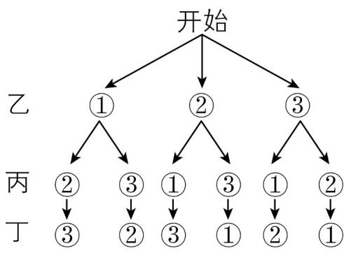

> [!success]- 必刷题
>
> > [!success] **【答案】** C
>
> > [!note]- **【解析】**
> > 如图(1),4个圆凳分别记为①②
> >
> > 刷有所得
> > 使用列表法求解放回、不放回概率问题时，“放回型”表格对角线有正常数值，“不放回型”表格对角线无数值.
> > - **③④**：设甲坐在圆凳④上,画树状图如图(2)所示:
> >
> > 
> >
> > 
> > 图(1)
> > 图(2)
> > 共有6种等可能的结果,其中甲坐在乙对面的结果有2种,∴甲坐在乙对面的概率为 $\frac{2}{6}=\frac{1}{3}$ .
> >
> > 故选 **C**.
