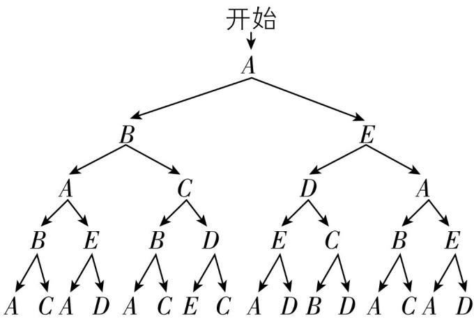

> [!success]- 必刷题
>
> > [!success] **【答案】** 50
>
> > [!note]- **【解析】**
> > 假设机器人跳到 C 处不会触发毁灭程序,则机器人跳 4 步的路线画树状图如下:
> >
> > 
> >
> > 由树状图可知共有 16 种路线, 没有路过 C 处的路线有 8 种, 所以机器人跳 4 步仍未毁灭的概率为 $8 \div 16 \times 100\% = 50\%$ . 故答案为 50.
