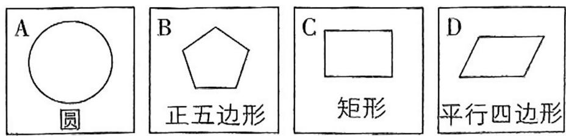

<!-- question-source:start -->
5 [2025 河南安阳校级调研]如图,有四张背面完全相同的纸牌 A、B、C、D,其正面分别画有四个不同的几何图形,将四张纸牌洗匀正面朝下随机放在桌面上.

(1)从四张纸牌中随机摸出一张,摸出的牌面图形是中心对称图形的概率是\_\_\_\_.

(2)小明和小亮约定做一个游戏,其规则为先由小明随机摸出一张,不放回,再由小亮从剩下的纸牌中随机摸出一张,若摸出的两张牌面图形既是轴对称图形又是中心对称图形,则小亮获胜,否则小明获胜.这个游戏公平吗?请用列表法(或画树状图法)说明理由.

<!-- question-source:end -->

![[Q00107898A1]]
