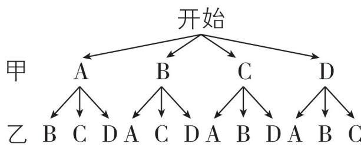
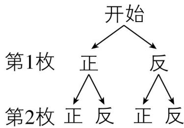

> [!success]- 必刷题
>
> > [!success] **【答案】** 详见解析
>
> > [!note]- **【解析】**
> > 【解】(1)画树状图如下:
> >
> > 
> >
> > 一共有 12 种等可能的结果, 其中乙选中球拍 C 有 3 种可能的结果, ∴ P(乙选中球拍 C) = $\frac{3}{12} = \frac{1}{4}$ .
> >
> > (2) 公平. 理由: 画树状图如下:
> >
> > 
> >
> > 一共有 4 种等可能的结果, 其中两枚硬币全部正面向上或全部反面向上有 2 种可能的结果, ∴ $P(\text{甲先发球}) = \frac{2}{4} = \frac{1}{2}$ , $P(\text{乙先发球}) = \frac{4 - 2}{4} = \frac{1}{2}$ . ∵ $P(\text{甲先发球}) = P(\text{乙先发球})$ , ∴ 这个约定公平.
