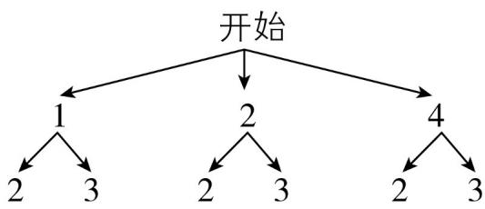

> [!success]- 必刷题
>
> > [!success] **【答案】** 详见解析
>
> > [!note]- **【解析】**
> > 【解】(1)从甲袋任意摸出一个小球,所有可能的结果为 1,2,4,共 3 种等可能的结果,恰好摸到数字为 1 的小球的结果只有 1 种,所以 $P$ (恰好摸到数字为 1 的小球) $= \frac{1}{3}$ .
> >
> > (2) 这个游戏公平. 理由如下:画树状图如下:
> >
> > 
> >
> > ## >思路分析
> >
> > (2) 画树状图得出所有等可能的结果, 得出小明获胜的结果数, 根据概率公式计算出小明获胜的概率, 再得出小亮获胜的概率, 进行比较即可得出结论.
> >
> > 共有6种等可能的结果,其中从甲袋摸出小球的数字小于从乙袋摸出小球的数字的共有3种结果,所以 $P(\text{小明获胜})=\frac{3}{6}=\frac{1}{2}$ ,则 $P(\text{小亮获胜})=\frac{1}{2},\frac{1}{2}=\frac{1}{2}$ ,所以这个游戏公平.
