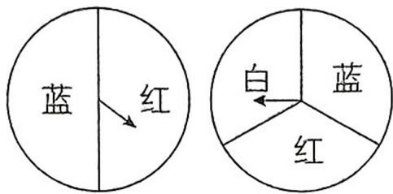

<!-- question-source:start -->
1 [2025 陕西汉中校级质检] 小明要用如图的两

个转盘做“配紫色”游戏,每个转盘均被等分成若干个扇形,他同时转动两个转盘,停止时

指针所指(若指针指向分界线则重转)的颜色恰好配成紫色(红+蓝=紫)的概率为 ( )
A. $\frac{1}{6}$ B. $\frac{1}{4}$ C. $\frac{1}{3}$ D. $\frac{1}{2}$
<!-- question-source:end -->

![[Q00107899A1]]
