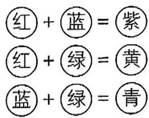

<!-- question-source:start -->
2 [2024 江苏徐州鼓楼区调研] 色光三原色(RGB)是指红、绿、蓝三色. 把这三种色光按一定比例混合可以呈现各种色光. 配色规律如图所示(例如: 红光和蓝光按一定比例混合可以呈现紫光).

(1)从色光三原色中随机选择一种色光,选中红光的概率为\_\_\_\_;
(2)甲、乙两位同学分别从色光三原色中随机选择一种色光进行混合,求可以呈现紫光的概率(用画树状图法或列表法).

<!-- question-source:end -->

![[Q00107900A1]]
