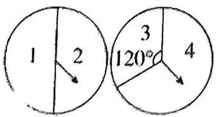
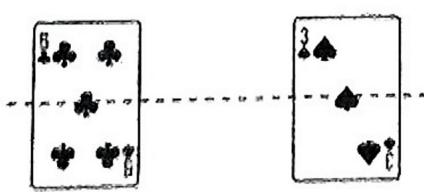

<!-- question-source:start -->
3 如图是超市的两个摇奖转盘, 只有当两个转盘指针同时指在偶数上时才能获一等奖, 则摇奖人中一等奖的概率是 ( )
A. $\frac{1}{2}$ B. $\frac{1}{3}$ C. $\frac{1}{4}$ D. $\frac{1}{6}$

(第3题图)

(第4题图)

建议用时 25 分钟 答案 042
<!-- question-source:end -->

![[Q00107901A1]]
