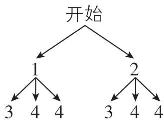

> [!success]- 必刷题
>
> > [!success] **【答案】** B
>
> > [!note]- **【解析】**
> > 在第二个转盘中,4对应的圆心角度数是 $240^{\circ}$ ,相当于4出现两次,3出现一次,画树状图如图.由图可知,一共有6种等可能的情况,其中两次都是偶数的有2种情况,故摇奖人中一等奖的概率是 $\frac{2}{6} = \frac{1}{3}$ ,故选B.
> >
> > 
