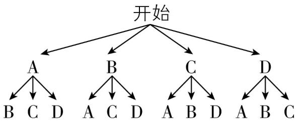

> [!success]- 必刷题
>
> > [!success] **【答案】** B
>
> > [!note]- **【解析】**
> > 将四张卡片分别记为 A, B, C, D, 其中 A 和 B 能拼成一张完整扑克牌, C 和 D能拼成一张完整扑克牌,画树状图如下:
> >
> > 
> >
> > 共有 12 种等可能的结果, 其中抽到的这两张卡片恰好能拼成一张完整扑克牌的结果有 AB, BA, CD, DC, 共 4 种, ∴ 抽到的这两张卡片恰好能拼成一张完整扑克牌的概率为 $\frac{4}{12} = \frac{1}{3}$ .
> >
> > 故选 **B**.
