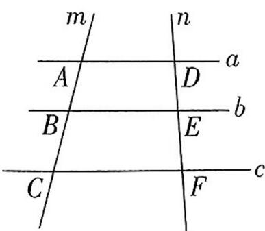
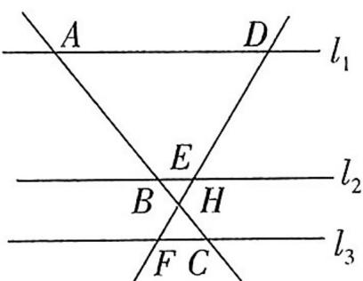

<!-- question-source:start -->
1 [2025 山西晋中期中]如图,小明在练习本上画出直线 $a \parallel b \parallel c$ , 直线 $m, n$ 分别与直线 $a, b, c$ 交于点 $A, B, C, D, E, F$ , 则下列比例式错误的是 ( )
A. $\frac{AB}{AC} = \frac{DE}{DF}$ B. $\frac{AB}{BC} = \frac{DE}{EF}$ C. $\frac{AD}{BE} = \frac{BE}{CF}$ D. $\frac{BC}{EF} = \frac{AC}{DF}$

(第1题图)

(第2题图)
<!-- question-source:end -->

![[Q00107963A1]]
