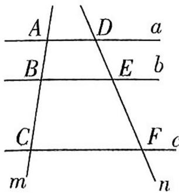

<!-- question-source:start -->
3 如图, 直线 $a \parallel b \parallel c$ , 直线 $m, n$ 与 $a, b, c$ 分别相交于点 $A, B, C$ 和点 $D, E, F$ .

(1) 若 $AB = 3, BC = 5, DE = 4$ , 求 $EF$ 的长.

(2) 若 $AB: BC = 2:5, DF = 10$ , 求 $EF$ 的长.

<!-- question-source:end -->

![[Q00107965A1]]
