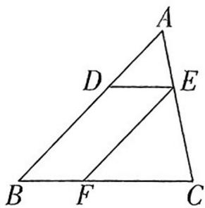
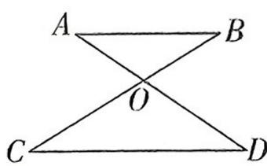

<!-- question-source:start -->
4 如图, 已知在 $\triangle ABC$ 中, 点 $D, E, F$ 分别是边 $AB, AC, BC$ 上的点, $DE \parallel BC$ , $EF \parallel AB$ , 且 $AD$ :

$DB = 3:5$ ，则 $CF:CB =$ （A.5：8 B.3：8 C.3：5 D.2：5

(第4题图)
(第5题图)
<!-- question-source:end -->

![[Q00107966A1]]
