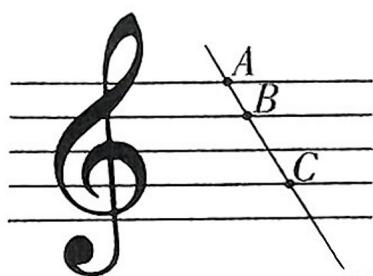

<!-- question-source:start -->
6 [2025 吉林长春质检] 如图, 五线谱是一种记谱法, 通过在五条等距离的平行线上标以不同时值的音符

及其他记号来记载音乐. 同一条直线上的三个点 A, B, C 分别在五线谱的三条平行线上, 若线段 BC = 4 cm, 则线段 AC 的长是 \_\_\_\_.
<!-- question-source:end -->

![[Q00107968A1]]
