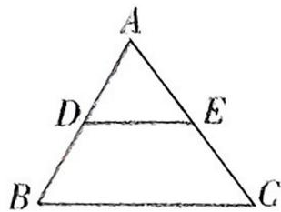

<!-- question-source:start -->
8 如图, 在 $\triangle ABC$ 中, 点 $D, E$ 分别在 $AB, AC$ 上, $DE \parallel BC$ , 下列比例式中, 不正确的是 ( )

A. $\frac{AD}{AB} = \frac{AE}{AC}$ B. $\frac{AD}{DB} = \frac{AE}{EC}$ C. $\frac{AB}{AC} = \frac{AE}{AD}$ D. $\frac{AD}{AE} = \frac{DB}{EC}$

<!-- question-source:end -->

![[Q00107970A1]]
