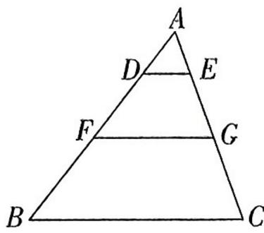
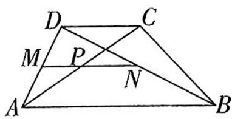

<!-- question-source:start -->
1 [2025 青海西宁校级质检, 中] 如图, $\triangle ABC$ 中, $DE \parallel FG \parallel BC$ , $AD:DF:FB = 2:3:4$ , 若 $EG = 4$ , 则 $AC$ 的长为 ( )
A. 10 B. 12 C. 15 D. 16

(第1题图)

(第2题图)
<!-- question-source:end -->

![[Q00107972A1]]
