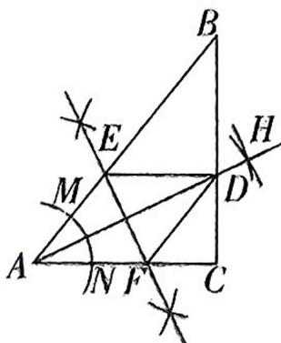
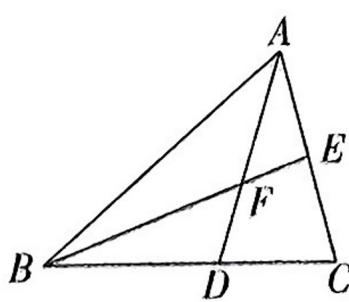

<!-- question-source:start -->
3[中]如图,在 $\triangle ABC$ 中, $\angle C=90^{\circ},BC=9$ ,以点A为圆心,适当长为半径画弧,分别交AB,AC于点M,N,分别以点M,N为圆心,大于 $\frac{1}{2}MN$ 的长为半径画弧,两弧交于点H,作射线AH交BC于点D,作线段AD的垂直平分线EF,分别交AB,AC于点E,F,连接DE,DF,CD=4,下列结论错误的是 ( )

A. AD平分 $\angle BAC$ B. AF=AE=DE=DF

C. 若DF=5,则 $S_{\triangle ADF}=10$ D. $S_{\triangle ADF}:S_{\triangle CDF}=5:4$

(第3题图)

(第4题图)
<!-- question-source:end -->

![[Q00107974A1]]
