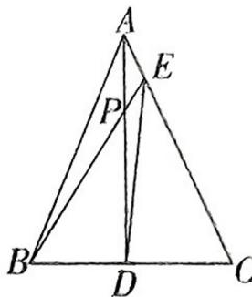

<!-- question-source:start -->
5[较难]如图,等腰三角形 ABC 中,AB=AC,P 点在 BC 边上的高 AD 上,且 $\frac{AP}{PD}=\frac{1}{2}$ ,BP 的延长线交 AC 于 E,连接 DE. 若 $S_{\triangle ABC}=10$ , 则 $S_{\triangle ABE}=$ \_\_\_\_ , $S_{\triangle DEC}=$ \_\_\_\_

2刷素养 ➤ 走向重高
<!-- question-source:end -->

![[Q00107976A1]]
