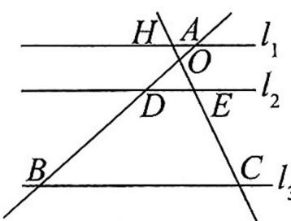
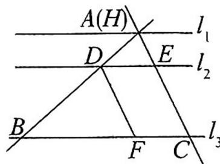
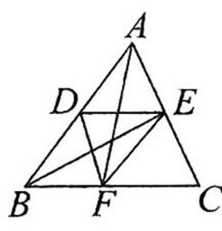

<!-- question-source:start -->
6 核心素养推理能力 [难] 如图(1), $l_{1} \parallel l_{2} \parallel l_{3}$ , 直线 $AB, CH$ 与 $l_{1}, l_{2}, l_{3}$ 分别相交于点 $A, D, B$ 和点 $H, E, C, AB$ 与 $CH$ 交于点 $O$ , 已知 $CE = 6, HE = 3, AB = 12$ . (1) 尝试探究: 在图(1)中, 求出 $DB$ 和 $AD$ 的长. (2) 类比延伸: 平移 $AB$ 使得点 $A$ 与点 $H$ 重合, 如图(2)所示, 过点 $D$ 作 $DF \parallel AC$ , 若 $DE = 5$ , 求线段 $BF$ 的长. (3) 拓展迁移: 如图(3), 若某个三角形 $ABC$ 的面积是 10 , 点 $D, E$ 分别位于 $AB, CA$ 上, $DE \parallel BC$ , 点 $F$ 在 $BC$ 上且 $BF = 2, CF = 3$ , 连接 $AF, EF$ . 如果 $\triangle CBE$ 的面积和四边形 $FCED$ 的面积相等, 求这个相等的面积值.

图(1)
图(2)

图(3)

电子错题本鸭
<!-- question-source:end -->

![[Q00107977A1]]
