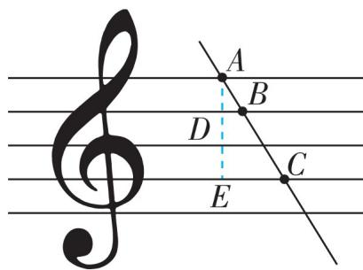

> [!success]- 必刷题
>
> > [!success] **【答案】** $6 \mathrm{~cm}$
>
> > [!note]- **【解析】**
> > 如图, 过点 A 作平行横线的垂线, 交点 B 所在的平行横线于 D, 交点 C 所在的平行横线于
> >
> > 
> >
> > $E, \therefore \frac{AB}{BC} = \frac{AD}{DE}$ , 即 $\frac{AB}{4} = \frac{1}{2}$ , 解得 $AB = 2, \therefore AC = 2 + 4 = 6$ (cm). 故答案为 $6 \mathrm{~cm}$ .
