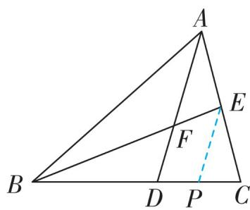

> [!success]- 必刷题
>
> > [!success] **【答案】** 2 ## - 添加辅助线 添加辅助线 分析题目条件,出现了四条线段 BF, FE, BD, DC, 所以考虑平行线分线段成比例,想到作平行线,而只有 BD 的长是已知的,所以辅助线尽量不要破坏 BD,这时考虑过 F 点作 AC 的平行线或过 E 点作 AD 的平行线,再联想到题目还给出 BE 为中线,所以 E 是 AC 的中点,所以过 E 点作 AD 的平行线.
>
> > [!note]- **【解析】**
> > 如图, 过点 E 作 $EP \parallel AD$ 交 BC 于点 P.
> > ∵ BE 是 $\triangle ABC$ 的中线，
> > ∴ AE = CE, ∴ DP = CP.
> > ∵ EP∥DF, ∴ $\frac{BD}{DP} = \frac{BF}{EF} =$
> >
> > 
> >
> > $$
> > 3, \therefore B D = 3 D P = 3, \therefore D P = 1, \therefore D C = 2 D P = 2.
> > $$
