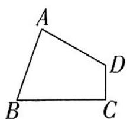
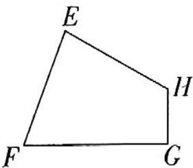

<!-- question-source:start -->
3 如图, 四边形 $ABCD \sim$ 四边形 $EFGH$ , $\angle A = 80^{\circ}$ , $\angle C = 90^{\circ}$ , $\angle F = 70^{\circ}$ , 则 $\angle H$ 等于 ( )

A. $70^{\circ}$ B. $80^{\circ}$ C. $110^{\circ}$ D. $120^{\circ}$
<!-- question-source:end -->

![[Q00107981A1]]
