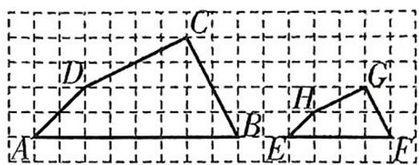

<!-- question-source:start -->
6 如图, 四边形 ABCD 和四边形 EFGH 相似(点 A 与点 E, 点 B 与点 F, 点 C 与点 G, 点 D 与点 H 分别是对应点), 且顶点都在方格纸的格点上, 它们的相似比是 ( )

A. $1:2$ B. $1:4$ C. $2:1$ D. $4:1$
<!-- question-source:end -->

![[Q00107983A1]]
