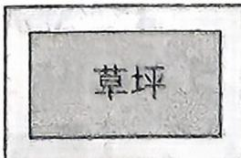

<!-- question-source:start -->
8 如图,一块矩形草坪长 $30 \, m$ , 宽 $20 \, m$ , 外围有等宽(宽度为 $2 \, m$ ) 的小路.

(1)内外两个矩形相似吗?

(2)要使内外两个矩形相似,相邻两条小路的宽度不相等,并且相对两条小路的宽度相等,仍保证外矩形的横向边为较长边,求相邻两条小路宽度的比值.

电子错题本鸭
<!-- question-source:end -->

![[Q00107985A1]]
