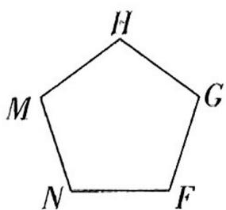
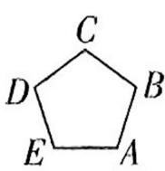

<!-- question-source:start -->
4[2025 宁夏吴忠校级质检]如图,正五边形FGHMN和正五边形ABCDE相似,若AB:FG=2:3,则下列结论正确的是()

A. $2DE = 3MN$ B. $3DE = 2MN$ C. $3\angle A = 2\angle F$ D. $2\angle A = 3\angle F$
<!-- question-source:end -->

![[Q00108282A1]]
