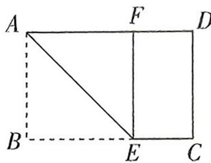
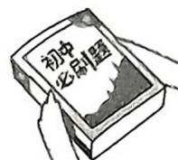

<!-- question-source:start -->
5 [2024 山东枣庄调研]如图,矩形ABCD中,AD为较长边,AB=1,在BC上取一点E,沿AE将△ABE

建议用时 20 分钟 答案 D49

向上折叠,使点 B 落在 AD 上的点 F 处,若四边形 EFDC 与矩形 ABCD 相似,则 AD= \_\_\_\_.

公主王子请刷题鸦
<!-- question-source:end -->

![[Q00108283A1]]
