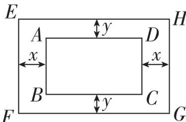

> [!success]- 必刷题
>
> > [!success] **【答案】** 详见解析
>
> > [!note]- **【解析】**
> > 【解】(1)不相似. 因为内矩形的长、宽分别为 $30 \mathrm{~m}, 20 \mathrm{~m}$ , 小路宽 $2 \mathrm{~m}$ , 则外矩形的长、宽分别为 $34 \mathrm{~m}, 24 \mathrm{~m}$ , 而 $\frac{30}{20} \neq \frac{34}{24}$ , 所以对应边不成比例, 所以内外两个矩形不相似.
> >
> > (2) 如图, 设相邻两条小路的宽度分别是 $x \mathrm{~m}$ 和 $y \mathrm{~m}$ . $\because$ 相对两条小路的宽度相等, $\therefore EF =$
> >
> > 
> >
> > $AB+2y=(20+2y)\mathrm{m},EH=AD+2x=(30+2x)\mathrm{m}.$ ∵ 矩形 EFGH 与矩形 ABCD 相似, ∴ $\frac{EF}{AB} = \frac{EH}{AD}$ ,
> > ∴ $\frac{20+2y}{20}=\frac{30+2x}{30},\therefore\frac{x}{y}=\frac{3}{2},\therefore$ 相邻两条小路宽度的比值为 $\frac{3}{2}\left(\text{或}\frac{2}{3}\right)$ .
> >
> > ## 易错警示
> >
> > (1) 判定两个多边形相似, 必须同时具备: ①边数相等;
> > - **②**：角对应相等;
> > - **③**：边对应成比例. 此题易错解为因为矩形的四个角都是直角, 对应角相等, 所以内外两个矩形相似.
> >
> > ## 4 探索三角形相似的条件
> >
> > ## 课时 1 相似三角形的概念及判定定理 1
