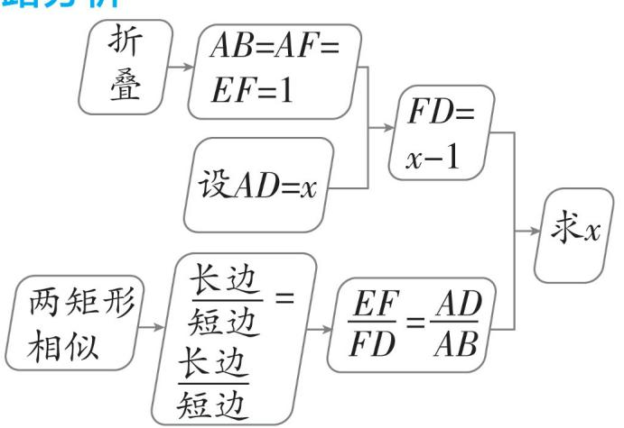

> [!success]- 必刷题
>
> > [!success] **【答案】** $\frac{1 + \sqrt{5}}{2}$
>
> > [!note]- **【解析】**
> > 
> > 【解析】∵沿AE将△ABE向上折叠,使点B落在AD上的点F处,AB=1,∴易知AF=EF=1.设AD=x,则FD=x-1.∵四边形EFDC与矩形ABCD相似,∴ $\frac{EF}{FD}=\frac{AD}{AB}$ ,即 $\frac{1}{x-1}=\frac{x}{1}$ ,解得$x_{1} = \frac{1 + \sqrt{5}}{2}, x_{2} = \frac{1 - \sqrt{5}}{2}$ （舍去），经检验 $x = \frac{1 + \sqrt{5}}{2}$ 是原方程的解. 故答案为 $\frac{1 + \sqrt{5}}{2}$ .
