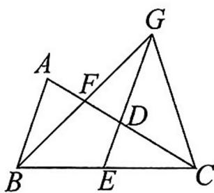

<!-- question-source:start -->
2 如图, 在 $\triangle ABC$ 中, $AC = BC$ , 点 $D, E, F$ 分别是线段 $AC, BC, AD$ 的中点, $BF, ED$ 的延长线交于点 $G$ , 连接 $GC$ .

(1) 求证: $AB = GD$ .

(2) 当 $CG = EG$ 时, 求 $\frac{AC}{AB}$ 的值.

<!-- question-source:end -->

![[Q00108044A1]]
