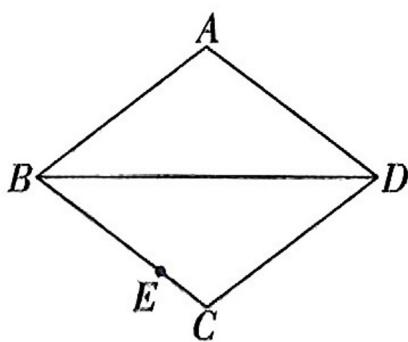

<!-- question-source:start -->
3[2025 福建福州质检]如图,已知菱形 ABCD 中,E 是 BC 边上一点.

(1) 在 BC 的右侧求作 $\triangle AEF$ ，使得 $EF \parallel BD$ ，且 $EF = \frac{1}{2} BD$ （要求尺规作图，不写作法，保留作图痕迹）；

(2)在(1)的条件下,若 $\angle EAF=\frac{1}{2}\angle ABC$ ,求证: $AE=\sqrt{2}EF.$

<!-- question-source:end -->

![[Q00108045A1]]
