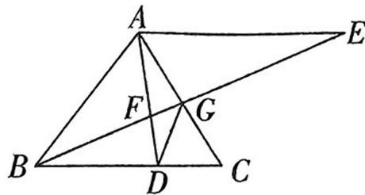

<!-- question-source:start -->
5 如图, 在 $\triangle ABC$ 中, 点 $D$ 在边 $BC$ 上, $AE \parallel BC$ , $BE$ 与 $AD, AC$ 分别相交于点 $F, G, AF^{2} = FG \cdot FE$ . (1) 求证: $\triangle CAD \sim \triangle CBG$ ;

(2) 连接 $DG$ , 求证: $DG \cdot AE = AB \cdot AG$ .

<!-- question-source:end -->

![[Q00108047A1]]
