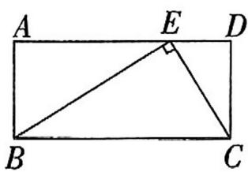
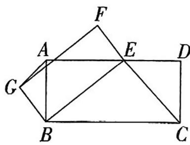

<!-- question-source:start -->
6[2025 山东济南质检]如图,在矩形 ABCD 中, AB = 2, BC = 5, 点 E 是边 AD 上一点, 连接 BE, CE.

(1)如图(1),当 $\angle BEC=90^{\circ}$ 时,求AE的长度;

(2)如图(2),以 BE 为边在 BE 的左侧作矩形 BEFG,且 BG:BE=2:5,连接 AG.

①求证: $\angle BAG = \angle BCE$ ;

②求证: $AG \perp CE$ .

图(1)

图(2)
<!-- question-source:end -->

![[Q00108048A1]]
