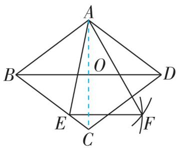
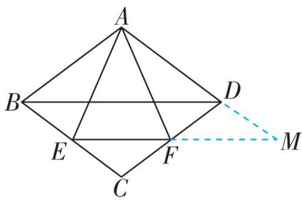

> [!success]- 必刷题
>
> > [!success] **【答案】** (1)【解】如图(1), $\triangle AEF$ 即为所求(作法不唯一).  图(1)  图(2) (2)
>
> > [!note]- **【解析】**
> > 【证明】如图(2)，延长 $EF$ 交 $AD$ 的延长线于点 $M$ . $\because$ 四边形 $ABCD$ 是菱形， $\therefore AB = AD, BC // AD, BD$ 平分 $\angle ABC$ . $\because DB // EM, BE // DM, \therefore$ 四边形 $BEMD$ 是平行四边形， $\therefore EM = BD$ . $\because BD = 2EF, \therefore EM = 2EF$ . $\because AB = AD, \therefore \angle ABD = \angle ADB = \frac{1}{2} \angle ABC$ . $\because \angle EAF = \frac{1}{2} \angle ABC, \therefore \angle EAF = \angle ADB$ . $\because BD // FM, \therefore \angle ADB = \angle M, \therefore \angle EAF = \angle M$ . $\because \angle AEF = \angle AEM, \therefore \triangle AEF \sim \triangle MEA, \therefore \frac{AE}{ME} = \frac{EF}{AE}, \therefore AE^2 = EF \cdot EM = 2EF^2, \therefore AE = \sqrt{2} EF$ .
