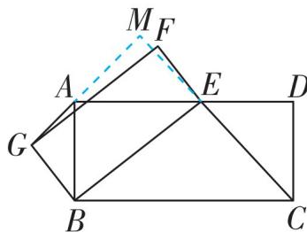

> [!success]- 必刷题
>
> > [!success] **【答案】** (1)【解】∵ 四边形 ABCD 是矩形, ∴ AB = CD = 2, BC = AD = 5, ∠A = ∠D = 90°. ∵ ∠BEC = 90°, ∴ ∠AEB = 90° - ∠DEC = ∠DCE, ∴ △ABE ∼ △DEC, ∴ $\frac{AB}{DE} = \frac{AE}{CD}$ , ∴ $\frac{2}{5 - AE} = \frac{AE}{2}$ , 解得 AE = 4 或 1, 经检验, AE = 4 和 AE = 1 都是方程的解, 且符合题意, ∴ AE 的长度是 4 或 1. (2)
>
> > [!note]- **【解析】**
> > 【证明】①∵四边形ABCD是矩形,四边形BEFG是矩形,∴∠ABC=∠GBE=90°,
> > ∴∠ABC-∠ABE=∠GBE-∠ABE,即∠EBC=
> > ∠ABG.∵AB=2,BC=5,BG:BE=2:5,∴ $\frac{AB}{BC}$ = $\frac{BG}{BE},\therefore \triangle ABG \sim \triangle CBE, \therefore \angle BAG = \angle BCE.$
> >
> > $$
> > C E, G A
> > $$
> >
> > 思路分析延长 $DF$ 交 $AB$ 于 $C$ , 构造相似三角形,从而利用相似三角形的性质求相应长度.
> >
> > $$
> > \therefore \angle B A D = 9 0 ^ {\circ}
> > $$
> >
> > $$
> > A D \parallel B C, \therefore \angle B A G +
> > $$
> >
> > $$
> > \angle M A E = 9 0 ^ {\circ}, \angle M E A =
> > $$
> >
> > $$
> > \angle B C E.
> > $$
> >
> > 
> >
> > $$
> > \angle B A G =
> > $$
> >
> > $\angle BCE, \therefore \angle BAG = \angle MEA, \therefore \angle MEA + \angle MAE = 90^{\circ}, \therefore \angle M = 90^{\circ}, \therefore AG \perp CE.$
