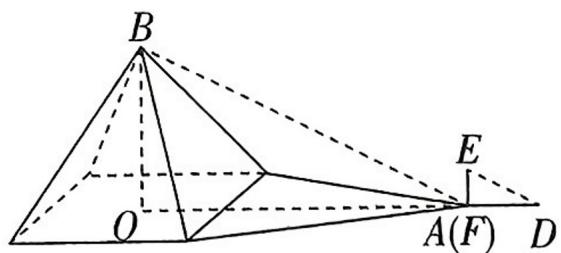

<!-- question-source:start -->
1 [2025 北京东城区质检] 古希腊科学家泰勒斯曾利用立杆测影的方法, 在金字塔影子的顶点处直立一根木杆, 借助太阳光测量出了金字塔的高度. 如图, 木杆 EF 长 2 米, 它的影长 FD 是 4 米, 同一时刻测得 OA 长 268 米, 则金字塔的高度 BO 是 \_\_\_\_ 米.

<!-- question-source:end -->

![[Q00108051A1]]
