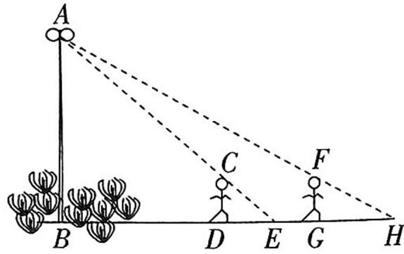

<!-- question-source:start -->
2 如图,花丛中有一路灯杆 $AB$ . 在灯光下,小明在 $D$ 点处的影长 $DE = 3$ 米,沿 $BD$ 方向行走到达 $G$ 点, $DG = 5$ 米,这时小明的影长 $GH = 5$ 米. 如果小明的身高为 1.7 米,求路灯杆 $AB$ 的高度.

<!-- question-source:end -->

![[Q00108052A1]]
