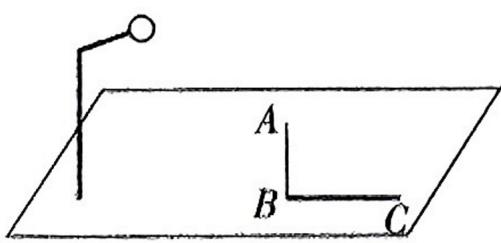
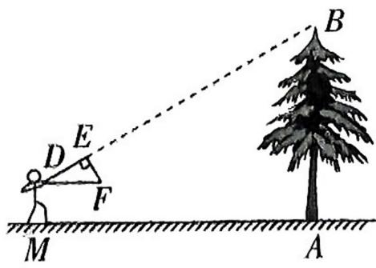

<!-- question-source:start -->
3[2025 山西太原期末]如图,为了确定路灯灯泡到地面的距离,小明与小亮选取了长1米的标杆AB,小明测得标杆在路灯下的影长BC=1.5米,从点B出发沿着CB方向行走7.5米后恰好走到路灯灯泡的正下方.据此可得,路灯灯泡到地面的距离为 ( )
A.5.6米 B.6米 C.6.4米 D.7.5米

(第3题图)

(第4题图)

建议用时 30 分钟 答案 D60
<!-- question-source:end -->

![[Q00108053A1]]
