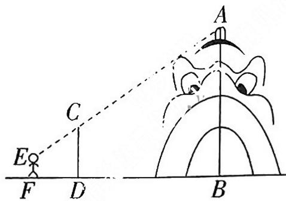

<!-- question-source:start -->
5[2025 广东佛山质检]如图,九年级(1)班课外活动小组想利用标杆测量佛山千灯湖市民广场醒狮雕塑的高度,已知点 A, C, E 在同一直线上,标杆高度 CD=2.8 m,标杆与雕塑的水平距离 BD=20 m,人的眼睛与地面的高度 EF=1.8 m,人与标杆 CD 的水平距离 DF=2 m,求醒狮雕塑 AB 的高度.

<!-- question-source:end -->

![[Q00108055A1]]
