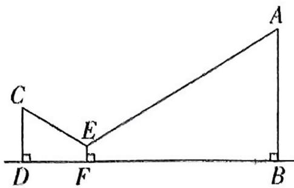

<!-- question-source:start -->
6[2023 浙江湖州中考]某数学兴趣小组测量校园内一棵树的高度,采用以下方法:如图,把支架(EF)放在离树(AB)适当距离的水平地面上的点F处,再把镜子水平放在支架(EF)上的点E处,然后沿着直线BF后退至点D处,这时恰好在镜子里看到树的顶端A,再用皮尺分别测量BF,DF,EF,观测者目高(CD)的长,利用测得的数据可以求出这棵树的高度.已知CD⊥BD于点D,EF⊥BD于点F,AB⊥BD于点B,BF=6米,DF=2米,EF=0.5米,CD=1.7米,则这棵树的高度(AB的长)是\_\_\_\_米.

<!-- question-source:end -->

![[Q00108056A1]]
