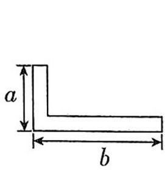
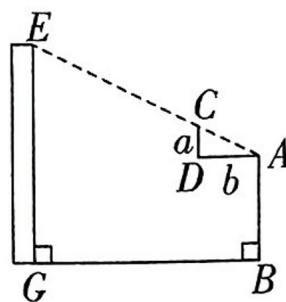

<!-- question-source:start -->
1 [中]西周数学家商高总结了用“矩”(如图(1))测量物高的方法:把“矩”水平放置在如图(2)所示的位置,从“矩”的一端A(人眼)望点E,使视线通过点C,记人站立的位置为点B,量出BG长,即可算得物高EG.令BG=x m,EG=y m,若a=30 cm,b=60 cm,AB=1.6 m,则y关于x的函数表达式为()

A. $y = \frac{1}{2} x$ B. $y = \frac{1}{2} x + 1.6$ C. $y = 2x + 1.6$ D. $y = \frac{180}{x} + 1.6$

图(1)

图(2)
<!-- question-source:end -->

![[Q00108058A1]]
