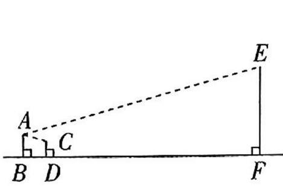
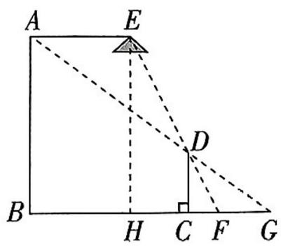

<!-- question-source:start -->
2[2025 天津河西区质检, 中]如图, 小明在墙上挂了一面镜子 $AB$ , 调整好标杆 $CD$ 的位置后, 正好可以顺着标杆顶部在镜子上边缘 $A$ 处看到旗杆的顶端 $E$ , 已知 $AB = 2 \mathrm{~m}, CD = 1.5 \mathrm{~m}, BD = 2 \mathrm{~m}, BF = 20 \mathrm{~m}$ , 则旗杆 $EF$ 的高度为 \_\_\_\_ m.

(第2题图)

(第3题图)
<!-- question-source:end -->

![[Q00108059A1]]
