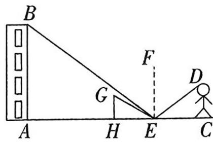

<!-- question-source:start -->
4 [中]小丽和小明想测量河对岸一建筑物的高度 $AB$ . 如图, 他们先在地面上放一面平面镜 $E$ , 小丽在射线 $AE$ 上调整自己与镜子的距离, 直到刚好能从镜子中看到建筑物的顶端 B, 此时她与镜子的距离 CE = 2 米, 然后小明在距离建筑物 6 米处安装了一个测倾器 GH, 测得 $\angle HGE = 60^{\circ}$ , 若小丽的眼睛距离地面的高度 CD = 1.6 米, GH = 1 米, $AB \perp AC$ , $GH \perp AC$ , $DC \perp AC$ , 点 A, H, E, C 在同一条直线上. 请你利用这些数据, 求建筑物的高度 AB. (结果精确到 0.1 米, 参考数据: $\sqrt{2} \approx 1.414$ , $\sqrt{3} \approx 1.732$ )

<!-- question-source:end -->

![[Q00108061A1]]
