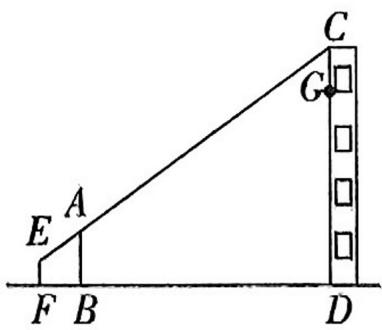
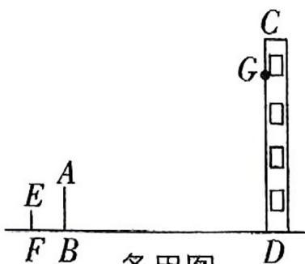

<!-- question-source:start -->
5 核心素养 数学建模 [较难] 学习了相似三角形相关知识后, 小明和同学们想利用标杆测量大楼的高度. 如图, 小明站立在地面上的点 $F$ 处, 他的同学在点 $B$ 处竖立标杆 $AB$ , 使得小明的头顶点 $E$ , 标杆顶点 $A$ , 大楼顶点 $C$ 在一条直线上 (点 $F, B, D$ 也在一条直线上). 已知小明的身高 $EF = 1.5$ 米, 标杆 $AB = 2.5$ 米, 且 $BD = 23$ 米, $FB = 2$ 米.

(1)求大楼的高度 $CD$ 为多少米 ( $CD$ 垂直于地面 $BD$ ).

(2)小明站在原来的位置,同学们通过移动标杆,可以用同样的方法测得楼 $CD$ 上点 $G$ 的高度 $GD = 11.5$ 米,那么相对于第一次测量,标杆 $AB$ 应该向大楼方向移动多少米?

备用图
<!-- question-source:end -->

![[Q00108062A1]]
