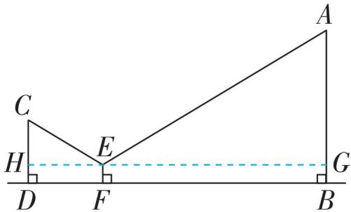

> [!success]- 必刷题
>
> > [!success] **【答案】** 4
>
> > [!note]- **【解析】**
> > 过点 E 作水平线交 AB 于点 G，交 CD 于点 H，如图。∵ $CD \perp DB, EF \perp DB, AB \perp DB, \therefore DH = EF = GB = 0.5$ 米，EH = DF = 2 米，EG = FB = 6 米，∴ CH = CD - DH = 1.7 - 0.5 = 1.2（米）。根据题意，得 $\angle CHE = \angle AGE = 90^{\circ}$ ， $\angle CEH = \angle AEG, \therefore \triangle CHE \sim \triangle AGE, \therefore \frac{EH}{EG} =$ $\frac{CH}{AG}$ , 即 $\frac{2}{6} = \frac{1.2}{AG}$ , $\therefore AG = 3.6$ 米, $\therefore AB = AG + GB = 3.6 + 0.5 = 4.1$ (米). 故答案为 4.1.
> >
> > 
