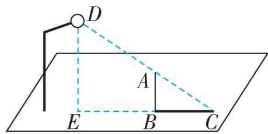

> [!success]- 必刷题
>
> > [!success] **【答案】** B
>
> > [!note]- **【解析】**
> > 如图，路灯灯泡的位置记为 $D$ ，作 $DE \perp BC$ 交 $CB$ 延长线于 $E$ ，
> >
> > 
> >
> > 连接 DC, 则 DC 经过点 A, DE 长即为灯泡到地面的距离. 由题意, 得 AB = 1 m, BC = 1.5 m, CE = 1.5 + 7.5 = 9 (m). ∵ AB // DE, ∴ 易得 △ABC ∼ △DEC, ∴ $\frac{AB}{DE} = \frac{CB}{CE}$ , ∴ $\frac{1}{DE} = \frac{1.5}{9}$ , ∴ DE = 6 m, ∴ 路灯灯泡到地面的距离为 6 m. 故选 B.
> >
> > 4.9 【解析】延长 $DF$ 交 $AB$ 于 $C$ , 则 $DC \perp AB$ , $\therefore \angle DEF = \angle BCD = 90^\circ$ . 又 $\because \angle EDF = \angle CDB$ , $\therefore \triangle DEF \sim \triangle DCB, \therefore \frac{EF}{BC} = \frac{DE}{DC}$ . $\because DE = 40 \text{ cm} = 0.4 \text{ m}, EF = 30 \text{ cm} = 0.3 \text{ m}, CD = AM = 10 \text{ m}$ , $\therefore \frac{0.3}{BC} = \frac{0.4}{10}, \therefore BC = 7.5 \text{ m}$ . $\because AC = DM = 1.5 \text{ m}, \therefore AB = AC + BC = 1.5 + 7.5 = 9 (\text{m})$ . 故答案为 9.
